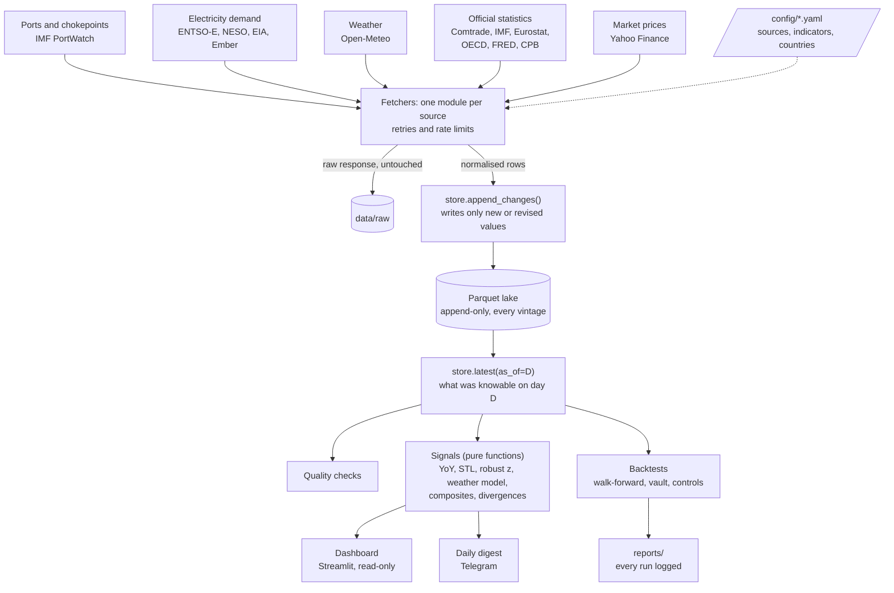
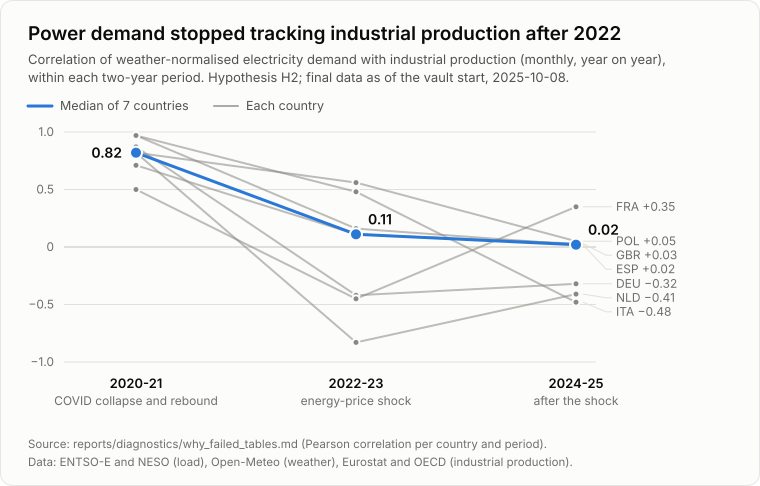

# Signal Tracker

**A point-in-time research system that tracks trade, industrial and energy data for 25 economies, flags where real activity and markets disagree, and tests honestly whether those flags predict anything.**

It collects daily port traffic, shipping-chokepoint transits, electricity demand, weather, official statistics and market prices from 13 public sources into an append-only store that remembers what was known on every past day. On top of that sit seasonal and weather adjustment, composite activity scores, divergence flags, a dashboard, a daily digest and a backtest engine built around pre-registration and a one-look holdout.

**The headline result is negative, and recorded as such.** Ten hypotheses were pre-registered and tested. None survived. The engine was checked with positive controls, placebos and an independent re-implementation, so the failures belong to the signals, not the code. The most instructive failure is below: [power demand stopped tracking industrial production after 2022](#finding-power-demand-and-industry-decoupled-after-2022).

> **Not financial advice.** This is a personal research project. Nothing in it is a recommendation to buy or sell anything, and no signal here has earned any trust.

**Contents:** [Architecture](#architecture) · [Data sources](#data-sources) · [Methodology](#methodology) · [Results](#results) · [Finding](#finding-power-demand-and-industry-decoupled-after-2022) · [Lessons learned](#lessons-learned) · [Tech stack](#tech-stack) · [Data and licences](#data-and-licences) · [Setup](docs/SETUP.md)

## At a glance

| | |
|---|---|
| Coverage | 25 major economies across the Americas, Europe, Asia-Pacific, the Middle East and Africa; 11 shipping chokepoints; 55 indicators |
| Pipeline | 13 fetchers, one per source; a scheduled daily run (fetch, quality checks, signals, backup, digest) |
| Store | Parquet files queried with DuckDB; every revision kept, each row stamped with when it became public |
| Research | 10 pre-registered hypotheses (nowcasts, trading rules, event forecasts), a 12-month vault, engine controls |
| Dashboard | Streamlit, 6 pages: Overview, Country, Indicator, Shipping and Chokepoints, Data Health, Signal Lab |
| Code | About 14,600 lines of Python and 6,400 lines of tests (500+ tests, saved API fixtures, no network) |

## Architecture



- **Fetchers** each talk to one source, save the raw response before parsing, and convert it to one schema: `date, country, indicator, value, unit, frequency, source, fetched_at, available_at, vintage_type`.
- **Config over code.** A new indicator is an entry in `config/indicators.yaml`; a new source is one fetcher module.
- **Signals and backtests are pure functions** (dataframes in, dataframes out). All file and network I/O lives in the store, the fetchers and the CLI, which keeps the research code testable without data.
- **Local-first.** No servers or databases: immutable Parquet files avoid Windows file locks between the dashboard and the daily pipeline.

## Data sources

All free. Five need a free API key ([setup](docs/SETUP.md#api-keys)).

| Source | What it provides | Frequency | Used for |
|---|---|---|---|
| [IMF PortWatch](https://portwatch.imf.org/) | Port calls and import/export volumes by country; transits through chokepoints (Suez, Panama, Hormuz, Malacca, ...) | daily, from 2019 | trade activity (H1, H4), chokepoint events (H5) |
| [ENTSO-E Transparency Platform](https://transparency.entsoe.eu/) | Actual total load, 6 European countries | hourly | power demand (H2, H6) |
| [NESO data portal](https://www.neso.energy/data-portal) | Great Britain electricity demand | half-hourly | power demand |
| [EIA API v2](https://www.eia.gov/opendata/) | US Lower 48 demand; industrial electricity sales | hourly, monthly | power demand |
| [Ember](https://ember-energy.org/) | Electricity demand and generation by fuel | monthly | energy activity |
| [Open-Meteo](https://open-meteo.com/) | Temperatures for 113 cities, population-weighted; heating and cooling degree days | daily | weather normalisation |
| [UN Comtrade](https://comtradeplus.un.org/) | Official exports and imports (Taiwan via partners' mirror data) | monthly | nowcast target (H1) |
| [IMF data portal](https://data.imf.org/) | Exports and imports for 24 countries (IMTS); copper and EU gas prices (PCPS) | monthly | nowcast target (H1b) |
| [Eurostat](https://ec.europa.eu/eurostat) and [OECD](https://data-explorer.oecd.org/) | Industrial production | monthly | nowcast target (H2) |
| [FRED / ALFRED](https://fred.stlouisfed.org/) | US industrial production with its real publication vintages; Brent, WTI, the broad dollar | daily, monthly | official data, markets |
| [CPB World Trade Monitor](https://www.cpb.nl/en/worldtrademonitor) | Trade volumes and prices | monthly | diagnostics |
| [Yahoo Finance](https://finance.yahoo.com/) (via `yfinance`) | Country ETFs, FX, MSCI World (URTH), sector ETFs and futures | daily | trading tests (H3-H6) |

## Methodology

### Point-in-time store

Every row carries `available_at`, the moment the value became public, and `vintage_type` (`live`, `source_vintage` or `estimated`).

- **Writes** go through `store.append_changes()`, which stores a row only if it is new or its value changed. Re-downloading unchanged data writes nothing; a revision becomes a new row. The result is a full revision history with no duplicates.
- **Reads** for any evaluation go through `store.latest(as_of=D)`, which only sees rows with `available_at <= D`. The dashboard can replay a country page as it looked on a past date the same way.
- **Real vintages** come from ALFRED for US industrial production, and from the daily runs themselves since the first live run (2026-09-27). Backfilled history has an estimated `available_at`: period end plus the indicator's typical publication lag, set per country where sources differ (China's Comtrade data arrives about 400 days late).
- **A leak test** (`tests/test_pit.py`) checks that no backtest can see a value before it was published.

### Signal processing

- **Daily data**: 28-day windows compared with the same 28 days 364 days earlier, so weekdays line up.
- **Moving holidays**: Lunar New Year, Ramadan and Eid, Easter, Diwali and Golden Week are flagged and interpolated per weekday. For Lunar New Year countries, January and February are combined.
- **Robust z-scores**: (x − 3-year rolling median) / (1.4826 × rolling MAD), so 2020 and the 2022 energy shock don't distort the scale.
- **Weather-normalised power demand**: daily load modelled on heating and cooling degree days, weekday, holidays and two annual harmonics, refitted monthly on the previous 3 years with Huber weights. A second indicator, **weekday overnight load** (00:00-05:00), sidesteps rooftop solar, which hides daytime demand.
- **Known structural breaks** (for example a change in what a grid operator reports) are listed in config, so year-on-year changes and z-scores never compare across them.
- **Composite activity score** per country (trade and energy categories, at least two indicators) and two **divergences**: activity against the country's ETF relative to MSCI World (market divergence), and against the latest official figure (official divergence). Flags need 3 consecutive weeks past the threshold and switch off with hysteresis.
- **A transform-chain engine** behind the dashboard labels every step as one-sided (real-time safe) or two-sided (uses later data), so look-ahead in a display can't leak into a hypothesis by accident.

### Backtesting protocol

1. **Pre-register** each hypothesis in [`docs/SIGNALS.md`](docs/SIGNALS.md) before testing it, with its target, horizon, expected sign and thresholds. Every run, failed or not, is logged to a `hypotheses_tested` table.
2. **Walk forward** with an expanding window: parameters come only from data before each test date.
3. **The vault**: the last 12 months (data published from 2025-10-08) are locked away. Each hypothesis gets exactly one look, at the end, and the code refuses a second.
4. **Benchmarks**: nowcasts against an AR model built from past official numbers; trading rules against buy-and-hold and against random entry dates with the same turnover.
5. **Metrics**: out-of-sample RMSE ratio, both halves of the test period, and a Diebold-Mariano test for nowcasts. For trading rules: returns after 10-20 bp per side plus borrow costs for shorts, Sharpe, and a deflated Sharpe that counts the variants tried. Event forecasts get Brier scores against the base rate.
6. **Multiple testing**: Bonferroni bars across the variants of each hypothesis; every test rerun without 2020.
7. **Graduation rule**: a signal graduates only if it beats its benchmark out of sample in both halves, survives costs, doesn't rely on 2020, and passes the vault. Then it needs 3 months of forward paper predictions before any real use.

### Controls: testing the test engine

A failed hypothesis only means something if the engine could have found a real effect. [`reports/diagnostics/CONTROLS.md`](reports/diagnostics/CONTROLS.md) checks that:

- **Positive control**: Comtrade exports nowcasting IMF exports (the same quantity from another source) cut the error by 67%.
- **Synthetic signals** (the answer plus noise of known size) are found, even at noise levels as large as the target's own swings.
- **Placebos**: 26 shifted or misplaced signals. One beat the benchmark; it was traced to the data, not a bug.
- **Independent re-implementation** of the nowcast arithmetic gives identical forecasts (to 1e-13).
- **Timing audit** from raw publication times: 0 of 1,107 forecasts used data that wasn't public yet.
- **Trading and event code** produce the expected extreme results with perfect foresight and with shuffled signals.

## Results

Every pre-registered hypothesis and its outcome. Details and numbers: [`reports/SUMMARY.md`](reports/SUMMARY.md), one report per hypothesis in [`reports/`](reports/).

| Id | Hypothesis | Test | Result | Outcome |
|---|---|---|---|---|
| H1 | Port export volumes nowcast official exports (Comtrade) | 820 nowcasts, 23 countries, 2022-2025 | 11% worse than the benchmark, in both halves | Failed |
| H1b | The same, for IMF exports (China included) | 858 nowcasts, 24 countries | 16% worse | Failed |
| H2 | Weather-normalised power demand nowcasts industrial production | 206 nowcasts, 7 European countries, 2023-2025 | 26% worse, in both halves | Failed |
| H2b | Weekday overnight load beats total load | the same 206 months | no difference (ratio 1.00) | Failed |
| H3 | Countries whose activity weakens before their market reacts underperform (short country ETF against MSCI World) | 38 trades, after costs | −6.4% a year, Sharpe −0.51; random timing did as well 40% of the time | Failed |
| H4 | Chinese port imports falling while copper is calm leads to copper falling (short copper miners) | 3 trades | −6.3% a year; random timing did as well 62% of the time | Failed |
| H5 | A sharp fall in chokepoint transits moves dry-bulk freight (BDRY) and Brent | 12 events in 2022-2025, then the vault | Training: +18.6% in 4 weeks against +0.8% normally, but p 0.04 against a multiple-testing bar of 0.004. Vault (7 events, 3 episodes): +3.0% against +6.2% at random dates, p 0.46 | Failed, including its one vault look |
| H6 | A European gas spike plus falling industrial power demand leads to European chemicals underperforming | 6 trades | all 6 lost, −7.2% a year | Failed |
| E2 | The official divergence predicts whether the next official print is weaker | 410 forecasts, 25 countries, 2024-2025 | Brier 0.250 against 0.252 for the base rate (p 0.73) | Failed |
| E3 | The system's probabilities move before prediction-market prices | n/a | no market priced these releases before the vault | Not testable on history |
| E1 | Trade collapses in food importers come before unrest | n/a | needs conflict and food-price data (ACLED, WFP) | Parked |

**Nothing graduates.** Eight hypotheses failed out of sample, so their vault stays unopened: a vault pass couldn't rescue them. H5 was the one lead. Its training result rested mostly on one episode, the 2023-24 Red Sea crisis, and it failed its pre-registered vault test on the opposite side to training. "Failed" here means "no evidence it works": the samples are short (most alternative data starts around 2019), so small effects can't be ruled out.

## Finding: power demand and industry decoupled after 2022

The idea behind H2 is old and intuitive: factories use electricity, so weather-adjusted power demand should track industrial production and arrive weeks before the official figure. In this data it did, but only during COVID.

<picture>
  <source media="(prefers-color-scheme: dark)" srcset="reports/figures/power_ip_decoupling_dark.svg">
  
</picture>

| Period | Median correlation, 7 countries | Range across countries |
|---|---|---|
| 2020-21 (COVID collapse and rebound) | 0.82 | 0.50 to 0.97 |
| 2022-23 (energy-price shock) | 0.11 | −0.83 to 0.56 |
| 2024-25 | 0.02 | −0.48 to 0.35 |

- **The link was the COVID swing.** In 2020-21 everything fell and rebounded together. From 2022 the correlation was near zero, and negative in Germany and the Netherlands.
- **It broke rather than being fitted badly.** Given the best whole-period coefficients in hindsight, the power signal still makes the 2023-25 forecasts 40% worse than leaving it out.
- **The likely mechanism** (not tested): in the 2022 energy-price shock, energy-intensive industry (chemicals, metals, paper, cement) cut power use far more than its share of industrial output, while output indices are weighted towards low-energy sectors such as pharmaceuticals and machinery. Rooftop solar, heat pumps and electric cars add load unrelated to industry. Power demand became a measure of energy-intensive industry and household electrification rather than of industry as a whole.
- **What it suggests**: a narrower target (production in energy-intensive sectors only), trained without 2020-2022. That refinement was shaped by looking at this data, so it can only be tested blind on forward data or its own unread vault year. Full diagnosis: [`reports/diagnostics/WHY_FAILED.md`](reports/diagnostics/WHY_FAILED.md); the chart is drawn from its tables by `scripts/make_figures.py`.

## Lessons learned

- **Build the honesty in before the results arrive.** Point-in-time reads, pre-registration commits, a vault the code guards, and logging every run made "none of it works" a credible finding instead of an embarrassment to tune away.
- **Test the engine, not only the signals.** Positive controls and placebos are what separate "the signal failed" from "the backtest is broken". They cost a day and settled the question.
- **Short samples are dominated by their regimes.** Most alternative data starts around 2019, so training windows were mostly COVID and the energy shock. Relationships learned there didn't hold afterwards, and even the benchmark was hurt: for H2, COVID-era training doubled its error.
- **Check the units of the target.** Ports measure tonnes; official exports are dollars. Since 2022, prices and the dollar explain most of the movement in US and world export values, so the port signal was partly chasing the wrong quantity.
- **Count episodes, not events.** H5's 12 training events were 5 independent episodes, and one crisis held 7 of them. Clustered events make a lead look far stronger than it is.
- **Plan the holdout's power before pre-registering.** In a one-year vault, about one placebo date in six overlaps the real events, so even a real effect would struggle to reach p < 0.05. That is worth knowing before spending the one look.
- **Start recording vintages on day one.** Backfilled history has only estimated publication dates. The real record starts with the first live run and can't be recreated later.

## Tech stack

- **Python 3.11**: pandas, PyArrow, DuckDB (store and queries); requests and tenacity (HTTP with retries); pydantic and PyYAML (config validation); statsmodels and SciPy (STL, regressions, tests); `holidays`
- **Source clients**: `entsoe-py`, `comtradeapicall`, `yfinance`
- **Dashboard**: Streamlit and Plotly
- **Testing**: pytest with saved API fixtures and no network calls; a pre-commit hook runs the full suite before every commit
- **Operations**: Windows Task Scheduler and PowerShell scripts for the daily run, backups and the dashboard service; Telegram Bot API for the digest

## Data and licences

This repository contains code, configuration, tests and reports. **No downloaded data is included or redistributed**: `data/` is git-ignored, and the sources' terms differ. Some require attribution, and some, such as Yahoo Finance's, don't allow redistribution at all. To rebuild the store, get the free keys and run the fetchers yourself ([setup](docs/SETUP.md)). The only third-party data in the repo are small saved API responses in `tests/fixtures/` (about 300 KB), kept so the tests run offline, and summary statistics in the reports.

The working session log is not part of this public copy, and `docs/JOURNAL.md` is the empty journal template.

**Licence.** The code and documents are released under the [MIT License](LICENSE). It covers this repository only, not the data the fetchers download, which stays under each source's own terms.

## Repository layout

```
tracker/      the Python package: settings, registry, store, quality, fetchers/, signals/, alerts/, backtest/
dashboard/    Streamlit app (views/ has one script per page)
config/       sources, indicators, countries, dashboard presets
scripts/      daily run, scheduling, backup and dashboard service (PowerShell); figures (Python)
tests/        pytest suite and saved API fixtures
reports/      one report per hypothesis, SUMMARY.md, diagnostics/ and figures/
docs/         PLAN (master plan and decision log), SIGNALS (pre-registrations), SETUP
```
